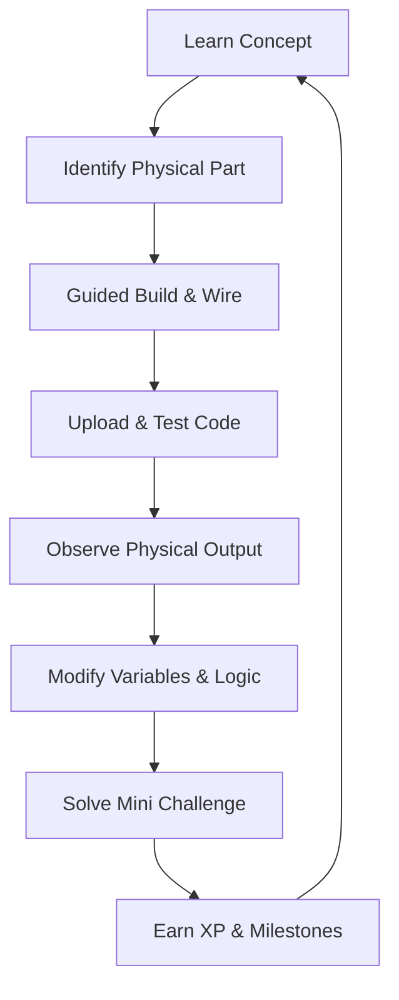
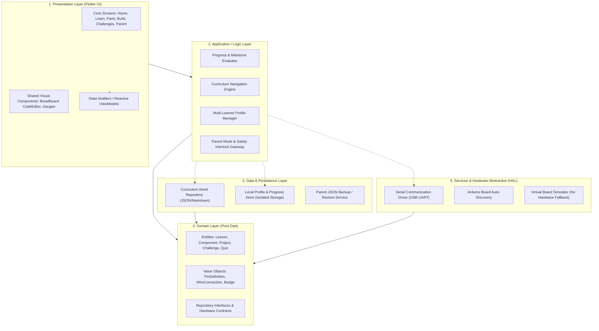

# 00 - Product Architecture Overview

## 1. System Vision & Purpose

**Monster Lab** is an offline-first, kid-focused robotics learning platform
engineered to transform the kit's 54 component entries and 20 projects into an
interactive, pedagogical discovery journey.

Rather than replicating a static textbook or manual, Monster Lab implements an active experiential cycle:
$$\text{Learn} \longrightarrow \text{Build} \longrightarrow \text{Test} \longrightarrow \text{Change} \longrightarrow \text{Explain}$$

---

## 2. Layered Clean Architecture

Monster Lab adheres to strict Clean Architecture boundaries, segregating presentation, application logic, domain entities, local persistence, and hardware communication into distinct layers.

---

## 3. Core Architectural Pillars

### Pillar 1: Data-Driven Curriculum Engine
- All lessons, component definitions, build guides, and challenges are stored in external, validated schemas (JSON/Markdown) rather than hardcoded into Flutter widgets.
- Adding a new project or updating a pin diagram never requires recompiling application UI logic.

### Pillar 2: 100% Offline-First
- Zero external internet dependency.
- All assets, tutorials, pinout tables, code examples, and progress tracking run completely on the local device.
- Zero tracking, telemetry, or user data collection.

### Pillar 3: Multi-Child Device Sharing
- Tablets and family computers are frequently shared among siblings.
- Profiles maintain independent progress sandboxes keyed by unique `learner_id`. One child unlocking advanced robotics projects never interferes with another child's beginner journey.

### Pillar 4: Decoupled Hardware Companion
- The application is a fully capable learning environment without physical hardware.
- When an Arduino board is connected over USB, the application seamlessly activates real-time telemetry, live sensor plotting, and auto-detection via an event-driven Hardware Abstraction Layer (HAL).
