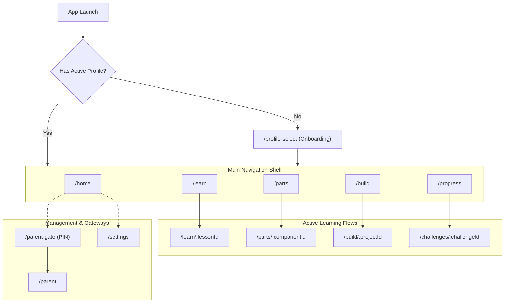
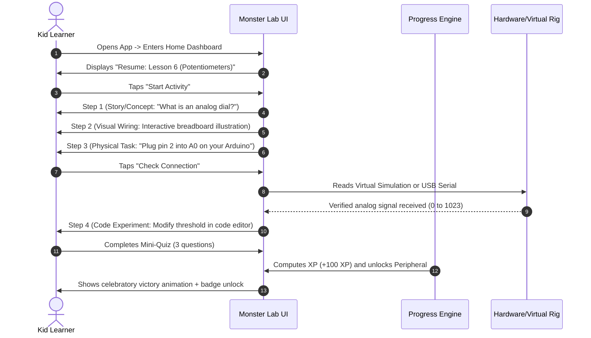

# 01 - Navigation and User Flows

## 1. Overview

This document details the navigation architecture, URL routing paths, and behavioral workflows for **Monster Lab**. It guarantees that the 8 core application areas are seamlessly interconnected and that both learners and parents have intuitive, dead-end-free experiences.

---

## 2. Core Areas & Route Map

Monster Lab implements a declarative routing hierarchy using `go_router`. It combines a persistent bottom navigation bar (via `ShellRoute`) with dedicated full-screen task flows.

### Complete Route Table

| Path | Route Name | Screen Purpose | Transition Type |
|---|---|---|---|
| `/` | `splash` | Checks local storage for active profile; redirects to `/home` or `/profile-select` | Fade |
| `/profile-select` | `profileSelect` | Avatar selection, profile switching, and new child onboarding | Modal Slide Up |
| `/home` | `home` | **Home**: Personalized dashboard: Resume learning, daily challenge, XP milestone | Tab Root |
| `/learn` | `learn` | **Learn** (Learn Lab): Category grid of foundational lessons across Rookie/Builder/Engineer | Tab Root |
| `/learn/:lessonId` | `lessonDetail` | Step-by-step interactive lesson (Story, Visual, Task, Quiz) | Push (Right to Left) |
| `/parts` | `parts` | **Parts Lab**: 38-Component interactive visual encyclopedia and filterable catalog | Tab Root |
| `/parts/:componentId` | `partDetail` | Detailed component view: Pinout, safe use, mini experiment, projects | Push (Right to Left) |
| `/build` | `build` | **Build Lab**: 14-Project family showcase with difficulty badges and unlock status | Tab Root |
| `/build/:projectId` | `buildDetail` | 8-Stage guided physical build flow (Gather -> Wire -> Code -> Test) | Full-screen Modal |
| `/challenges` | `challenges` | **Challenges**: Categorized challenge arena (Identify, Fix Wiring, Modify Code) | Push (Right to Left) |
| `/challenges/:challengeId` | `challengeDetail` | Timed or untimed challenge activity with interactive checkpoints | Full-screen Modal |
| `/progress` | `progress` | **Progress**: Learner trophy room: Badges, XP graph, discovered parts gallery | Tab Root |
| `/parent-gate` | `parentGate` | Parental verification barrier (4-digit PIN or arithmetic challenge) | Dialog / Modal |
| `/parent` | `parentDashboard` | **Parent Mode**: Parent view: Time spent, safety toggles, data export/import, curriculum reset | Full-screen Modal |
| `/settings` | `settings` | **Settings**: Audio/sound effects volume, theme toggles, accessibility options | Push (Right to Left) |

---

## 3. Learner Experience Flow

### 3.1 First Launch & Profile Creation
1. **Welcome Screen**: Friendly Monster mascot greets learner.
2. **Avatar Selection**: Child chooses from 8 colorful robotic monster avatars.
3. **Profile Name**: Child enters nickname (no personal identity information required).
4. **Age/Skill Calibration**: Selects age bracket (Ages 7-9 Rookie, Ages 10-12 Builder, Ages 13+ Engineer).
5. **Initial Reward**: Receives first "Welcome to the Lab" badge and 50 XP starter bonus.

### 3.2 Daily Learning Session Loop

---

## 4. Parent Experience Flow

### 4.1 Safety & Access Gateway
To prevent young children from accidentally altering settings, changing system difficulty, or disabling safety interlocks, Parent Mode is protected by a dual-verification gate:
- **Default Gate**: Arithmetic challenge (e.g. "Calculate: 7 × 8 = ?").
- **Custom Gate**: Optional 4-digit custom parental PIN set in Parent Settings.

### 4.2 Parent Dashboard Capabilities
1. **At-a-Glance Telemetry**: Total time active this week, lessons completed, projects assembled, challenges mastered.
2. **Concept Audit**: Highlights skills mastered (e.g. "Learned Ohm's law basics", "Configured I2C bus", "Wrote first loop").
3. **Safety Interlocks**:
   - Enable/disable Class 2/3R Laser Module experiments (Project 11).
   - Enable/disable MQ-9 combustible gas and MQ-3 alcohol experiments.
   - Restrict high-speed motor rotation projects for younger children.
4. **Data Management & Privacy**:
   - **Local Backup / Export**: Generates a plaintext local JSON string that can be saved to device storage or shared; protect the exported file because it is not encrypted.
   - **Data Import**: Restores progress from a previous device without cloud accounts.
   - **Curriculum Reset**: Reset single learner profile or individual project progress for repeated hands-on practice.
