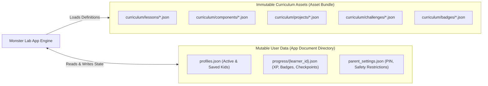

# 03 - Local Data and Persistence Architecture

## 1. Overview

**Monster Lab** operates on an offline-first storage model. No remote network calls or cloud databases are used. All curriculum content is bundled as immutable application assets, while user-generated data (learner profiles, XP, badges, and project checkpoints) are persisted in local sandboxed storage.

---

## 2. Storage Separation Strategy



---

## 3. Repository Interfaces

To support testability, the application layer communicates exclusively with repository contracts:

```dart
abstract class ICurriculumRepository {
  Future<List<Lesson>> getLessons({DifficultyTier? tier});
  Future<Lesson> getLessonById(String id);
  Future<List<Component>> getComponents({String? category});
  Future<Component> getComponentById(String id);
  Future<List<Project>> getProjects({DifficultyTier? tier});
  Future<Project> getProjectById(String id);
  Future<List<Challenge>> getChallenges({String? relatedLessonId});
}

abstract class IProfileRepository {
  Future<List<LearnerProfile>> getAllProfiles();
  Future<LearnerProfile?> getActiveProfile();
  Future<void> setActiveProfile(String profileId);
  Future<void> saveProfile(LearnerProfile profile);
  Future<void> deleteProfile(String profileId);
}

abstract class IProgressRepository {
  Future<LearnerProgress> getProgressForLearner(String learnerId);
  Future<void> recordLessonCompleted(String learnerId, String lessonId, int xpEarned);
  Future<void> recordComponentDiscovered(String learnerId, String componentId);
  Future<void> recordProjectPhase(String learnerId, String projectId, int phaseNumber);
  Future<void> recordProjectCompleted(String learnerId, String projectId, int xpEarned, String badgeId);
  Future<void> recordChallengeSolved(String learnerId, String challengeId, int xpEarned);
  Future<void> resetProgress(String learnerId);
}

abstract class IParentRepository {
  Future<bool> verifyParentPin(String enteredPin);
  Future<void> setParentPin(String newPin);
  Future<ParentSafetySettings> getSafetySettings();
  Future<void> updateSafetySettings(ParentSafetySettings settings);
  Future<String> exportBackupPayload();
  Future<bool> restoreFromBackupPayload(String jsonPayload);
}
```

---

## 4. Multi-Learner Isolation Mechanism

To guarantee that multiple siblings on a single device never overwrite each other's achievements:
1. Every write to `IProgressRepository` requires an explicit `learner_id`.
2. Each profile's progress is saved into its own partitioned key/file: `progress/{learner_id}.json`.
3. Switching profiles triggers a clean state swap without restarting the app.

---

## 5. Backup, Export, and Import Format

Parents can export the entire household's learning journey as a clean JSON document for device migration or archival backup.

```json
{
  "manifestVersion": "1.0",
  "exportedAt": "2026-09-28T12:00:00Z",
  "appVersion": "1.0.0",
  "parentSettings": {
    "pinConfigured": true,
    "laserModuleUnlocked": false,
    "highHeatGasSensorUnlocked": false
  },
  "profiles": [
    {
      "id": "e9b28f72-9114-49c0-9a25-c632194b1509",
      "nickname": "Sparky",
      "avatarId": "monster_bolt",
      "ageBracket": "ages10_12",
      "createdAt": "2026-09-20T10:00:00Z",
      "lastActiveAt": "2026-09-28T11:45:00Z"
    }
  ],
  "progress": {
    "e9b28f72-9114-49c0-9a25-c632194b1509": {
      "totalXp": 850,
      "currentLevel": 5,
      "completedLessonIds": ["lesson_01", "lesson_02", "lesson_03", "lesson_04", "lesson_05"],
      "discoveredComponentIds": ["comp_01", "comp_20", "comp_34"],
      "completedProjectIds": ["proj_01"],
      "projectStepBookmarks": {
        "proj_04": 3
      },
      "earnedBadgeIds": ["badge_first_blink", "badge_ultrasonic_scout"],
      "quizBestScores": {
        "quiz_lesson_05": 100
      }
    }
  }
}
```
