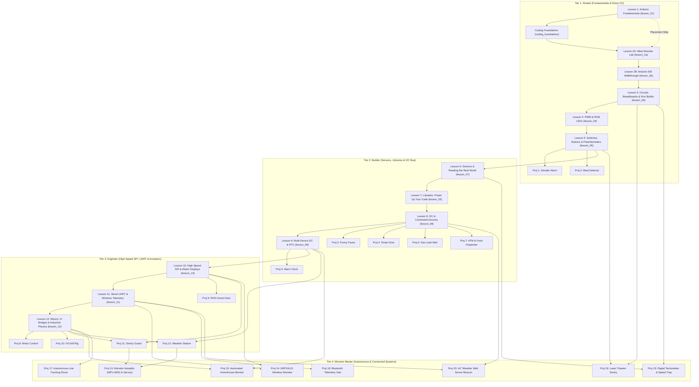

# 04 - Lesson & Project Dependency Map

## 1. Overview

This document defines the conceptual prerequisites, progression trees, and unlock conditions across the entire Monster Lab curriculum. It ensures that every activity builds strictly on previously validated concepts—preventing learners from being confronted with unexplained code, wiring, or physics.

---

## 2. Mastery Progression Tiers

---

## 3. Peripheral Prerequisite Matrix

Before introducing any peripheral in **Parts Lab**, the learner must possess the prerequisite concepts listed below:

| Peripheral Group | Peripherals Included | Prerequisite Concepts Required |
|---|---|---|
| **Simple Digital Inputs/Outputs** | #04 Impact Switch, #18 IR Obstacle, #28 Vibration, #34 Buzzer, #37 Laser, #38 Hall Effect | Lesson 1 (Hardware), Lesson 3 (Circuits & Breadboards), Lesson 5 (Digital Inputs & Pull-ups), Closed Circuits |
| **Simple Analog Inputs** | #19 Photoresistor (LDR), #20 Potentiometer, #21 PS2 Joystick, #22 Rain Sensor, #26 Soil Moisture, #35 Water Level | Lesson 5 (Potentiometers & Voltage Dividers), Lesson 6 (Sensors & `analogRead()`), 10-bit discrete ADC counts (0–1023) |
| **PWM & Discrete Actuation** | #25 Servo Motor, #33 DC Motor, #27 Stepper Motor | Lesson 4 (PWM Duty Cycle & Frequency), Lesson 12 (Motor Drivers, H-Bridges & Flyback Clamping Diode Protection) |
| **I2C Serial Displays & Sensors** | #07 1602 LCD, #08 BMP180 Pressure, #10 DS3231 RTC, #12 MPU-6050 IMU | Lesson 7 (Library Management), Lesson 8 (I2C Bus Protocol, SDA/SCL, Pull-ups), Lesson 9 (Multi-Device Arbitration) |
| **Matrix & Scanning Devices** | #06 4x4 Membrane Keypad, #15 MAX7219 LED Matrix, #32 7-Segment Display, #50 74HC595 | Lesson 5 (Keypad matrix row/column scanning), Lesson 10 (SPI Shift Register / MAX7219 Multiplexing) |
| **SPI High-Speed Peripherals** | #23 RFID Set (RC522), #30 Ethernet Shield, #31 NRF24L01 Wireless Transceiver | Lesson 10 (SPI Protocol: MOSI, MISO, SCK, CS/SS arbitration), 3.3V logic level shifting and voltage isolation |
| **UART & Telemetry Transceivers** | #29 HC-05/06 Bluetooth, #42 ESP32, #43 ESP8266, #48 ESP-01 | Lesson 11 (Asynchronous Serial Framing, Baud Rates, TX/RX crossing, 3.3V logic division) |
| **Specialized Sensors** | #01 Ultrasonic (HC-SR04), #09 DHT11 Temp/Humidity, #11 IR Flame, #13 IR Remote, #14 Line Tracking, #16 MQ-3, #17 MQ-9, #24 Rotary Encoder | Timing pulse analysis (`pulseIn`), state change interrupts, environmental calibration, quadrature state decoding |

---

## 4. Project Prerequisite Matrix

All 20 projects have strict unlock criteria to guarantee that learners never get stuck on unearned concepts:

| Project | Prerequisites Required (Lessons & Components) | Unlock Verification Criteria |
|---|---|---|
| **Proj 01: Intruder Alarm** | Lessons 1, 2A, 2B, 3, 5; Peripheral #01 (Ultrasonic), #03 (PIR), #28 (Vibration), #34 (Buzzer) | Successfully measure distance with pulse timing; trigger buzzer alarm on threshold crossing. |
| **Proj 02: Beat Detector** | Lessons 1, 2B, 3, 5; Peripheral #02 (Sound Sensor) | Calibrate microphone analog noise floor; toggle LED beat indicator on acoustic pressure spikes. |
| **Proj 03: Funny Faces** | Lessons 3, 7, 8, 10; Peripheral #13 (IR Remote), #15 (MAX7219 Matrix) | Decode infrared remote hex codes; display animated facial expressions on 8x8 matrix via SPI. |
| **Proj 04: Smart Door** | Lessons 3, 4, 5, 7; Peripheral #06 (Keypad), #25 (Servo), #34 (Buzzer), #52 (Switch) | Read pressed keypad passcode matrix; drive PWM servo horn from 0° (locked) to 90° (unlocked). |
| **Proj 05: Alarm Clock** | Lessons 7, 8, 9; Peripheral #07 (1602 LCD), #10 (DS3231 RTC), #34 (Buzzer), #47 (4-Digit Display) | Poll I2C real-time clock registers; print formatted time string; trigger audible alarm match. |
| **Proj 06: Gas Leak Alert** | Lessons 3, 5, 6, 8; Peripheral #07 (1602 LCD), #16 (MQ-3), #17 (MQ-9), #34 (Buzzer) | Read analog gas sensor ADC counts; evaluate PPM safety threshold; update LCD alarm display. |
| **Proj 07: ATM & Food Dispenser** | Proj 04; Peripheral #06 (Keypad), #07 (LCD), #25 (Servo), #50 (74HC595) | Multi-state transaction state machine; validate PIN array; actuate dispensing servo mechanism. |
| **Proj 08: Motor Control** | Lessons 5, 12; Peripheral #20 (Pot), #21 (Joystick), #27 (Stepper), #33 (DC Motor), #49 (L293D) | Drive stepper via ULN2003 sequence; regulate DC motor PWM speed/direction via L293D with flyback diode protection. |
| **Proj 09: RFID Smart Door** | Proj 04; Lesson 10; Peripheral #23 (RC522 RFID), #25 (Servo) | Read 4-byte RFID UID over 3.3V level-shifted SPI; unlock servo on authorized UID match. |
| **Proj 10: Oil Drill Rig** | Proj 05, Proj 08; Peripheral #07 (LCD), #24 (Rotary Encoder), #27 (Stepper) | Decode quadrature encoder pulses; position stepper drill head; display depth telemetry on LCD. |
| **Proj 11: Sentry Guard** | Proj 01; Lesson 4; Peripheral #01 (Ultrasonic), #07 (LCD), #11 (Flame), #18 (IR Proximity), #25 (Servo), #34 (Buzzer), #37 (Laser) | Sweep servo pan mount continuously while tracking distance; target laser on proximity detection. |
| **Proj 12: Weather Station** | Proj 05; Lesson 6; Peripheral #07 (LCD), #08 (BMP180), #09 (DHT11), #19 (LDR), #22 (Rain), #25 (Servo), #35 (Depth), #51 (Thermistor) | Sample multi-sensor analog/I2C weather telemetry; compute barometric altitude; log conditions to LCD. |
| **Proj 13: Monster Autopilot** | Proj 08, Proj 11; Peripheral #04 (Collision), #07 (LCD), #12 (MPU-6050), #18 (IR), #25 (Servo), #27 (Stepper) | Read 6-axis IMU accelerometer/gyroscope registers; calculate tilt angle; counter-steer servo stabilizer. |
| **Proj 14: Wireless Monster** | Proj 08, Proj 09; Lesson 10; Peripheral #25 (Servo), #31 (NRF24L01), #40 (Nano), #41 (Mega) | Transmit structured RF packet over SPI; parse payload on receiver board; actuate motor response. |
| **Proj 15: Automated Greenhouse** | Proj 05, Proj 12; Peripheral #07 (LCD), #09 (DHT11), #26 (Soil), #34 (Buzzer), #36 (Relay) | Monitor soil moisture and temperature; trigger optocoupled relay water pump when below threshold. |
| **Proj 16: Laser Tripwire Sentry** | Lessons 3, 5, 6; Peripheral #19 (LDR), #34 (Buzzer), #37 (Laser) | Align red laser beam with LDR sensor; trigger latching alarm state if beam connection is broken. |
| **Proj 17: Autonomous Rover** | Lessons 5, 12; Peripheral #04 (Bump Switch), #14 (Line Tracking), #33 (DC Motors), #49 (L293D) | Dual-photodiode line following algorithm; reverse and turn on front collision switch impact. |
| **Proj 18: Bluetooth Telemetry** | Lesson 11; Peripheral #07 (LCD), #20 (Pot), #29 (HC-05/06 BT) | Parse wireless ASCII commands from mobile terminal; stream sensor telemetry packets over UART. |
| **Proj 19: Digital Tachometer** | Lessons 5, 6; Peripheral #05 (Photo Interrupter), #32 (7-Seg), #38 (Hall Effect), #50 (74HC595) | Attach hardware interrupt to rotating magnet pass; calculate RPM; display on shift-register 7-segment. |
| **Proj 20: IoT Weather Beacon** | Proj 12; Lesson 11; Peripheral #08 (BMP180), #09 (DHT11), #30 (W5100), #42 (ESP32), #43 (ESP8266), #48 (ESP-01) | Host lightweight embedded HTTP web server; serve live temperature and barometric pressure JSON endpoint. |
