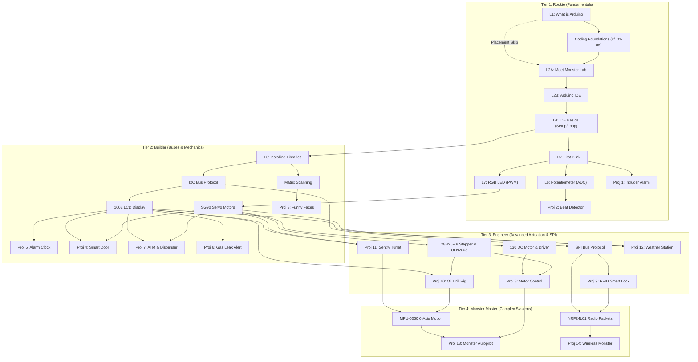

# 04 - Lesson & Project Dependency Map

## 1. Overview

This document defines the conceptual prerequisites, progression trees, and unlock conditions across the entire Monster Lab curriculum. It ensures that every activity builds strictly on previously validated concepts—preventing learners from being confronted with unexplained code, wiring, or physics.

---

## 2. Mastery Progression Tiers

---

## 3. Peripheral Prerequisite Matrix

Before introducing any peripheral in **Parts Lab**, the learner must possess the prerequisite concepts listed below:

| Peripheral Group | Peripherals Included | Prerequisite Concepts Required |
|---|---|---|
| **Simple Digital Inputs/Outputs** | #04 Impact Switch, #18 IR Obstacle, #28 Vibration, #34 Buzzer, #37 Laser, #38 Hall Effect | Lesson 1 (Hardware), Lesson 5 (Digital I/O & `pinMode`), Closed Circuits & Pull-up Resistors |
| **Simple Analog Inputs** | #19 Photoresistor (LDR), #20 Potentiometer, #21 PS2 Joystick, #22 Rain Sensor, #26 Soil Moisture, #35 Water Level | Lesson 6 (Analog Voltage Dividers & `analogRead()`), 10-bit resolution (0-1023) |
| **Actuators & PWM** | #25 Servo Motor, #33 DC Motor, #27 Stepper Motor | Lesson 7 (Pulse Width Modulation & duty cycle), Power budget (Current demands) |
| **I2C Serial Displays & Sensors** | #07 1602 LCD, #08 BMP180 Pressure, #10 DS3231 RTC, #12 MPU-6050 IMU | Lesson 3 (Library Management), Lesson 4 (Serial), I2C 2-Wire Protocol (SDA/SCL) |
| **Matrix & Scanning Devices** | #06 4x4 Membrane Keypad, #15 MAX7219 LED Matrix, #32 7-Segment Display | Matrix scanning principles, multiplexing, shift registers (74HC595) |
| **SPI High-Speed Peripherals** | #23 RFID Set (RC522), #30 Ethernet Shield, #31 NRF24L01 Wireless Transceiver | SPI Protocol (MOSI, MISO, SCK, CSN), 3.3V logic level constraints |
| **Specialized Sensors** | #01 Ultrasonic (HC-SR04), #09 DHT11 Temp/Humidity, #11 IR Flame, #13 IR Remote, #14 Line Tracking, #16 MQ-3, #17 MQ-9, #24 Rotary Encoder | Timing pulse analysis (`pulseIn`), digital wave reading, state change interrupts, environmental calibration |

---

## 4. Project Prerequisite Matrix

Each of the 14 projects has strict unlock criteria to guarantee that learners never get stuck on unearned concepts:

| Project | Prerequisites Required (Lessons & Components) | Unlock Verification Criteria |
|---|---|---|
| **Proj 01: Intruder Alarm** | Lessons 1, 2, 4, 5; Peripheral #01 (Ultrasonic), #34 (Buzzer) | Successfully measure distance using serial monitor; trigger LED on threshold. |
| **Proj 02: Beat Detector** | Lessons 1, 4, 5, 6; Peripheral #02 (Sound Sensor) | Successfully calibrate microphone analog noise floor; toggle pin output on spike. |
| **Proj 03: Funny Faces** | Lessons 3, 4; Peripheral #13 (IR Remote), #15 (MAX7219 Matrix) | Decode infrared remote keys; display static pattern on 8x8 matrix. |
| **Proj 04: Smart Door** | Lessons 3, 5; Peripheral #06 (Keypad), #25 (Servo), #34 (Buzzer) | Read pressed keypad button; sweep servo from 0° to 90°. |
| **Proj 05: Alarm Clock** | Lessons 3, 4; Peripheral #07 (1602 LCD), #10 (DS3231 RTC), #34 (Buzzer) | Print live clock time to I2C LCD; compare two integer timestamps. |
| **Proj 06: Gas Leak Alert** | Lessons 3, 6; Peripheral #07 (1602 LCD), #17 (MQ-9), #34 (Buzzer) | Read analog gas sensor; display status string on 1602 LCD. |
| **Proj 07: ATM & Dispenser** | Project 04 (Smart Door); Peripheral #06 (Keypad), #07 (LCD), #25 (Servo) | Build multi-state menu navigation; validate 4-digit PIN against array. |
| **Proj 08: Motor Control** | Lessons 6, 7; Peripheral #21 (Joystick), #27 (Stepper), #33 (DC Motor) | Drive stepper motor via ULN2003; regulate DC motor speed with analog joystick. |
| **Proj 09: RFID Smart Door** | Project 04 (Smart Door); Peripheral #23 (RC522 RFID), #25 (Servo) | Read 4-byte RFID UID over SPI; match against authorized keycard array. |
| **Proj 10: Oil Drill Rig** | Project 05, Project 08; Peripheral #07 (LCD), #24 (Rotary Encoder), #27 (Stepper) | Decode quadrature encoder rotation; navigate LCD drill depth menu. |
| **Proj 11: Sentry Guard** | Project 01 (Intruder Alarm); Peripheral #01 (Ultrasonic), #07 (LCD), #25 (Servo), #37 (Laser) | Sweep servo pan mount while maintaining continuous ultrasonic distance radar. |
| **Proj 12: Weather Station** | Project 05 (Alarm Clock); Peripheral #07 (LCD), #09 (DHT11), #22 (Rain), #35 (Water Level), #25 (Servo) | Multi-sensor telemetry sampling; drive sluice gate servo based on depth. |
| **Proj 13: Monster Autopilot**| Project 08, Project 11; Peripheral #07 (LCD), #12 (MPU-6050), #25 (Servo), #27 (Stepper) | Read pitch/roll Euler angles from MPU-6050; implement inverse servo stabilization. |
| **Proj 14: Wireless Monster** | Project 08, Project 09; Peripheral #31 (NRF24L01 Transceiver), 2x Arduino Boards | Transmit packet payload from Node A to Node B; execute motion command on remote node. |
