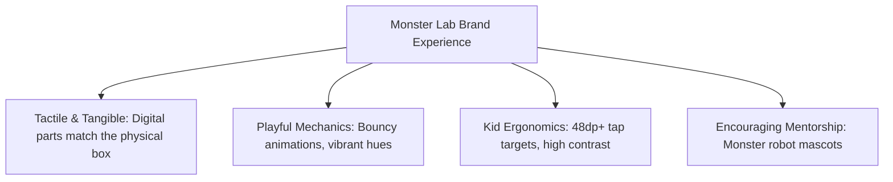

# 00 - Visual Design System Overview

## 1. Monster Lab Branding & Personality

**Monster Lab** bridges physical robotics hardware and digital software learning for kids. The visual design language is energetic, inviting, playful, and approachable—replacing dry, sterile engineering schematics with tactile, colorful, and engaging visual experiences.

---

## 2. The Monster Mascot Companions

Rather than faceless instruction manuals, learners are guided by four friendly robotic mascots representing different engineering disciplines:

| Mascot Name | Aesthetic / Persona | Discipline Role | Mascot Color Token |
|---|---|---|---|
| **Bolt** | Energetic, curious, lightning-bolt antenna | **Foundations & Rookie Lab**: Introduces electricity, safe circuits, and first blink. | `#FDCB6E` (Energy Amber) |
| **Sparky** | Analytical, glowing cyan visor, sensor probes | **Parts Lab & Sensors**: Explains how sensors translate the physical world into data. | `#00CEC9` (Neon Cyan) |
| **Geary** | Sturdy, tread-wheels, mechanical gear ears | **Build Lab & Mechanics**: Guides physical assembly, servo horns, and motor mounting. | `#E17055` (Terracotta Coral) |
| **Byte** | Sleek, digital dot-matrix visor, futuristic | **Code Lab & Challenges**: Teaches logic, loops, conditional branches, and debugging. | `#6C5CE7` (Electric Violet) |

---

## 3. Core Design Principles

### Principle 1: Physical-Digital Parity
When a child looks at the screen, the virtual component must match what is sitting on their workbench.
- Jumper wire colors on screen (Red, Black, Yellow, Green, Blue) strictly match physical cables.
- Sensor illustrations clearly show physical pin labels (`VCC`, `GND`, `TRIG`, `ECHO`, `SDA`, `SCL`) in identical orientation to the hardware module.

### Principle 2: Immediate Sensory Feedback
Children learn through exploration.
- Tapping a pin highlights connected breadboard traces in glowing neon cyan.
- Uploading code triggers a visual pulsing data stream animation.
- Successful wiring connections produce a satisfying mechanical click sound and green checkmark.

### Principle 3: Ergonomic Touch & Legibility
Designed specifically for smaller hands and varying device sizes:
- Minimum interactive touch target: **48 × 48 dp** (56 dp on tablet screens).
- Generous corner radiuses (12dp to 24dp) provide a soft, friendly, modern aesthetic.
- Zero small body text (minimum body size: 16sp).
