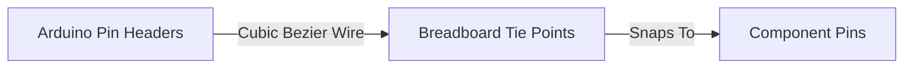

# 03 - Specialized Learning Widgets & Styling

## 1. Overview

Teaching physical electronics to kids requires specialized interactive UI widgets that bridge code, circuits, and physical components. This document establishes the styling specifications for **Interactive Wiring Diagrams**, the **Guided Code Lab**, and **Lesson Step Components**.

---

## 2. Interactive Breadboard & Wiring Diagram Styling



### 2.1 Virtual Breadboard Surface
- **Color**: Realistic matte off-white (`#F8F9FA`) with textured center gutter dividing the terminal strips.
- **Power Rails**:
  - Positive Rail: 2dp Red stripe (`#FF4757`) labeled with `+` signs.
  - Negative/Ground Rail: 2dp Blue stripe (`#0984E3`) or Black stripe labeled with `-` signs.
- **Tie Points**: Subtle dark grey circular apertures (`#B2BEC3`), diameter 6 dp, with touch-target hitboxes expanding to **24 × 24 dp** for effortless finger touch.

### 2.2 Wire Rendering & Bezier Conventions
- **Stroke Width**: 4 dp with 1dp darker border stroke to ensure high contrast against light surfaces.
- **Wire Geometry**: Rendered as smooth cubic Bezier curves ($P_0, P_1, P_2, P_3$) with vertical drop shadow (`0 3px 6px rgba(0,0,0,0.2)`) so overlapping cables are immediately distinguishable.
- **Connection Terminals**: Circular cable boots matching the wire color, terminating in shiny silver pin tips.
- **Interactive Pin Snapping**: When a learner drags a wire from an ultrasonic sensor's `TRIG` pin, Arduino digital pin `D9` pulses with an animated cyan target ring.

---

## 3. Code Display & Editor Styling

Instead of forcing a 9-year-old to type boiler-plate C++ syntax with semicolons on a virtual tablet keyboard, Monster Lab uses a **Guided Hybrid Code Viewer**.

```c
// Example: Arduino Syntax Palette
#include <LiquidCrystal_I2C.h>

void setup() {
  pinMode(13, OUTPUT);      // Built-in LED
  Serial.begin(9600);
}

void loop() {
  digitalWrite(13, HIGH);   // Turn LED ON
  delay(1000);              // Wait 1 second
  digitalWrite(13, LOW);    // Turn LED OFF
  delay(1000);
}
```

### 3.1 Syntax Highlighting Tokens
| Syntax Element | Color Name | Hex Token | Example in Arduino C++ |
|---|---|---|---|
| **Keywords & Control** | `syntaxKeyword` | `#FF7675` (Pink Coral) | `void`, `int`, `if`, `else`, `return` |
| **Built-in Functions** | `syntaxFunction` | `#00CEC9` (Neon Cyan) | `pinMode`, `digitalWrite`, `analogRead` |
| **Constants & Numbers** | `syntaxConstant` | `#FDCB6E` (Amber Gold) | `HIGH`, `LOW`, `INPUT`, `OUTPUT`, `1000` |
| **Strings & Characters**| `syntaxString` | `#55EFC4` (Mint Green) | `"Distance: "`, `"Alert!"` |
| **Comments & Notes** | `syntaxComment` | `#A4B0BE` (Muted Slate)| `// Connect to pin 9` |
| **Preprocessor** | `syntaxPreproc` | `#A29BFE` (Soft Lilac) | `#include <Servo.h>` |

### 3.2 Interactive Variable Badges
- Key variables (e.g. `int delayTime = [ 1000 ];` or `int threshold = [ 50 ];`) appear as tappable, glowing pill buttons inside the code editor.
- Tapping the badge opens a friendly stepper or slider, letting kids see how changing `delayTime` immediately alters the blinking speed of the on-screen LED.

---

## 4. Lesson Step & Checkpoint Components

### 4.1 Concept Story Step Card
- Features a conversational prompt from the active mascot guide.
- Highlights key technical vocabulary with a dotted underline; tapping the word displays a 1-sentence kid-friendly glossary popover (e.g. *"Voltage: Think of it like water pressure pushing electricity through a pipe!"*).

### 4.2 Physical Task Checklist
- Displays large, tactile checkboxes (minimum **32 × 32 dp**).
- Checking a task animates with a bouncy scale transform, plays a soft click, and highlights the next task.

### 4.3 Quiz Question Container
- Question text styled in `headlineMedium` (20sp semi-bold).
- Answer options formatted as large, pill-shaped cards (minimum height 56 dp).
- **Feedback States**:
  - Correct Selection: Animates green (`#00B894`), displays happy mascot animation, and reveals a clear explanation.
  - Incorrect Selection: Softly shakes horizontally, turns warm amber (`#FFA502`), and offers an encouraging hint with no negative penalty.
