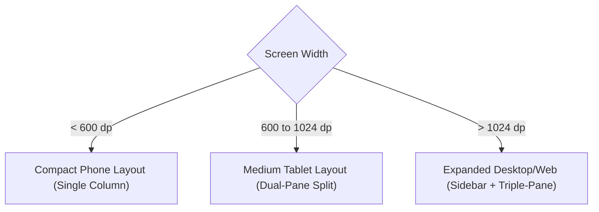

# 04 - Accessibility & Responsive Layouts

## 1. Overview

Monster Lab must be accessible and responsive across diverse learning environments: budget Android tablets in classrooms, family iPads on living room floors, Chromebooks, desktop PCs, and mobile phones.

This document establishes the **Accessibility Standards (WCAG 2.1 AA/AAA)** and the **Responsive Layout Breakpoints**.

---

## 2. Accessibility Guidelines

### 2.1 Contrast Standards
- **Standard Body Text**: Minimum contrast ratio of **7.0:1** (WCAG AAA) on light surfaces (`#2D3436` text on `#FFFFFF` / `#F8F9FD` background yields 14:1).
- **Interactive UI & Buttons**: Minimum contrast ratio of **4.5:1** (WCAG AA).
- **Wire Colors on Breadboard**: Every digital wire features a 1dp high-contrast outline to remain distinct against both white breadboard surfaces and overlapping colored jumper cables.

### 2.2 Colorblind-Safe Design
Color is never the sole conveyer of information:
- Success states pair green hues with explicit checkmark icons ($\checkmark$).
- Error / warning states pair amber/red with alert icons ($\triangle$) and text labels.
- Interactive wires display both color and textual pin abbreviations (e.g. `[VCC: RED]`, `[GND: BLK]`).

### 2.3 Kid Ergonomics & Touch Target Dimensions
- **Absolute Minimum Target Size**: **48 × 48 dp**.
- **Recommended Tablet Target Size**: **56 × 56 dp**.
- **Touch Margins**: Minimum 8dp spacing between adjacent tappable targets to eliminate accidental taps by younger children.

### 2.4 Dynamic Text Scaling
- Layouts are engineered to gracefully scale up to **200% (2.0x)** system font size without breaking cards or causing overflow errors.
- Flexible text containers utilize auto-wrapping and scrollable inner regions.

---

## 3. Responsive Layout Breakpoints

### Breakpoint Matrix

| Form Factor | Breakpoint Width | Navigation Chrome | Build Lab Layout | Parts Lab Layout |
|---|---|---|---|---|
| **Compact (Phone)** | `< 600 dp` | Persistent Bottom Navigation Bar (5 tabs) | Stacked single-column with tab switcher between Breadboard and Code | 2-Column Grid of Component Cards |
| **Medium (Tablet)** *(Primary Platform)* | `600 dp – 1024 dp` | Persistent Navigation Rail (Left) or Bottom Bar | **Dual-Pane Split View**: Left pane = Interactive Breadboard; Right pane = Step Guide & Code Editor | 3 or 4-Column Grid with quick preview sheet |
| **Expanded (Desktop / Web)** | `> 1024 dp` | Expanded Navigation Drawer with labeled text | **Triple-Pane Studio**: Left = Step Guide; Center = Virtual Breadboard; Right = Live Code & Serial Monitor | 4 or 5-Column Grid with persistent component inspector |

---

## 4. Tablet Landscape Optimization (Dual-Pane Architecture)

Because robotics and electronics learning is predominantly practiced with tablets resting horizontally on workbenches:
1. **Side-by-Side Context**: The learner never loses sight of the wiring diagram while reading code or completing checklist steps.
2. **Proportional Split**:
   - 55% screen width dedicated to the visual breadboard canvas and physical pin alignment.
   - 45% screen width dedicated to the active step instruction card, code snippet, and verify button.
3. **Orientation Handling**: If rotated to Portrait, the layout smoothly stacks with a toggle tab allowing quick switching between the circuit and code.
