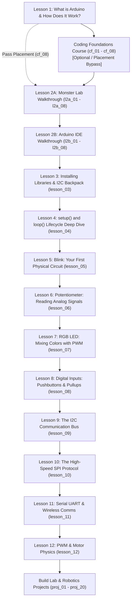

# 25 — Master Curriculum Report

**Curriculum Guardian Audit & Governance**  
**Target Audience**: Ages 6+ (Tiered: Rookie 6–8, Builder 9–11, Engineer 12+)  
**Status**: APPROVED WITH REVISIONS

---

## 1. Executive Summary

This Master Curriculum Report establishes the unified, verified educational architecture of **Monster Lab**, resolving all historical contradictions between early roadmap plans (`plan/00`–`plan/18`), expansion blueprints (`plan/19`–`plan/21`), modern interactive structures (`plan/22`–`plan/23`), and responsive mobile design (`plan/24`).

Monster Lab delivers a child-safe, hands-on, offline-first physical computing and robotics curriculum. It bridges tangible electronic hardware (Arduino Uno R3 and 38 peripherals) with foundational computational thinking.

---

## 2. Intended Curriculum Order & Course Structure

The validated learning path moves from broad conceptual orientation to foundational programming, workspace tooling, electronics hardware physics, communication buses, and multi-component autonomous systems.

### Course Breakdown

1. **Lesson 1 (`lesson_01`)**: What is Arduino & How Does It Work? *(Rookie, 18 min)*
2. **Course: Coding Foundations (`coding_foundations`)**: 8 bite-sized modules (`cf_01`–`cf_08`), 90 min total. Optional; placement assessment (`cf_08`) grants equivalent prerequisites.
3. **Course: Lesson 2A (`lesson_2a`)**: Monster Lab Walkthrough (`l2a_01`–`l2a_08`), 15 min total. Teaches app areas (Learn, Parts, Build, Code, Challenges).
4. **Course: Lesson 2B (`lesson_2b`)**: Arduino IDE Walkthrough (`l2b_01`–`l2b_08`), 20 min total. Teaches IDE GUI, boards, ports, serial monitor, libraries, compile/flash loop.
5. **Lesson 3 (`lesson_03`)**: Installing Libraries: Supercharging Code *(Builder, 18 min)*
6. **Lesson 4 (`lesson_04`)**: Basics of the Arduino IDE: Setup and Loop *(Rookie, 18 min)*
7. **Lesson 5 (`lesson_05`)**: Blink: Your First Physical Circuit *(Rookie, 20 min)*
8. **Lessons 6–12**: Analog sensing, PWM color synthesis, digital switches with internal pull-ups, I2C, SPI, UART, and Motor/H-Bridge physics.

---

## 3. Age & Difficulty Progression (6+ Target Audience)

Monster Lab adopts a **3-tier progressive depth** model to support learners from ages 6 to 14+ without artificial oversimplification:

### Tier 1: Rookie (Ages 6–8)
- **Pedagogical Strategy**: Concrete, physical, highly visual metaphors. Short text blocks (2–3 sentences max per paragraph).
- **Core Loop**: Direct cause-and-effect (e.g., button press → LED glow).
- **Technical Accuracy Scaffolding**: Explain microcontrollers as "a tiny robot brain" while accurately introducing GPIO pins and closed circuit loops (+5V to GND).

### Tier 2: Builder (Ages 9–11)
- **Pedagogical Strategy**: System integration, multi-pin communication, modular code libraries, and quantitative reasoning (e.g., ADC 0–1023 conversion, PWM duty cycle 0–255).
- **Core Loop**: Multi-step logic and component coordination (e.g., keypad entry triggering servo unlock).

### Tier 3: Engineer (Ages 12+)
- **Pedagogical Strategy**: Formal register concepts (PORTB5, ATmega328P architecture), communication protocols (I2C clock/data arbitration, SPI full-duplex MOSI/MISO, UART framing), and electrical physics (inductive flyback EMF, current limits).
- **Core Loop**: Diagnostic prediction, systematic troubleshooting, and autonomous system design.

---

## 4. Prerequisite Graph & Placement Architecture

### Placement-Equivalence Invariant
- **Rule**: A learner who passes the placement assessment (`cf_08` in `coding_foundations`) receives placement status (`markPlacementPassed('coding_foundations')`).
- **Prerequisite Fulfillment**: All subsequent lessons requiring `coding_foundations` accept either full course completion or passing the placement assessment.
- **Zero Circularity**: The dependency tree is strictly acyclic, verified by `CurriculumValidator.validateCurriculumIntegrity`.

---

## 5. Code Comprehension & Learning Loops

All lessons enforce two mandatory instructional loops:

### 1. The Core Learning Loop
$$\text{Learn} \longrightarrow \text{Build} \longrightarrow \text{Test} \longrightarrow \text{Change} \longrightarrow \text{Explain}$$
Passive reading-only steps are prohibited. Every lesson contains physical board inspections, circuit assembly, or interactive software simulations.

### 2. The Code Comprehension Loop
$$\text{Read} \longrightarrow \text{Predict} \longrightarrow \text{Change} \longrightarrow \text{Run} \longrightarrow \text{Observe} \longrightarrow \text{Explain}$$
Blind copy-pasting is actively eliminated. Code blocks deconstruct keywords, parameters, and register consequences. Predictions must be submitted before observing runtime telemetry.

---

## 6. Safety Audit & Child-Safe Standards

All hardware activities adhere to the child-safe experimentation protocols:
- **Zero Open Flame Policy**: Flame sensor (`comp_11`) experiments use TV IR remotes or flashlights; matches and lighters are strictly forbidden.
- **Absolute Prohibition of AC Mains**: 5V Relay module (`comp_36`) is locked to low-voltage DC ($\le 12\text{V}$ DC) only.
- **Safe Gas Sensor Testing**: MQ-3/MQ-9 sensors (`comp_16`, `comp_17`) prohibit raw fuel/lighter fluid; use alcohol swabs or breath simulation.
- **Laser Safety Protocol**: KY-008 Laser (`comp_37`) is locked behind Parent Mode by default, with LED drop-in alternatives provided.
- **Inductive Flyback Protection**: Motor and relay circuits mandate flyback diodes (1N4007) and dedicated power supplies.
- **Reverse Polarity & Short-Circuit Mitigation**: Clear GND invariants and current limits (20mA pin nominal, 40mA absolute max) are reinforced throughout.

---

## 7. Timing & Meaningful Engagement
- Each individual standalone lesson is budgeted for **15–20 minutes** of active engagement.
- Modular sub-lessons in courses 2A, 2B, and Coding Foundations are calibrated for **3–5 minutes** per bite-sized unit.
- Time estimates reflect genuine reading, diagram exploration, interactive simulation, and hands-on assembly, with zero artificial filler.

---

## 8. Mobile & Visual Learning Experience (Phase 24 Standards)
- **Inline Preview → Tap to Expand → Full-Screen Interactive Viewer**: Detailed pinouts, breadboard schematics, and timing diagrams can be explored without shrinking text.
- **Responsive Code Blocks**: Monospace font with horizontal scroll and line numbers, preventing page-wide viewport stretching.
- **System Insets & Edge-to-Edge Navigation**: Action buttons respect gesture navigation bars and 3-button system bars.
- **Immersive Lesson Mode**: Defaults to OFF; provides distraction-free learning when toggled by learner or educator.
